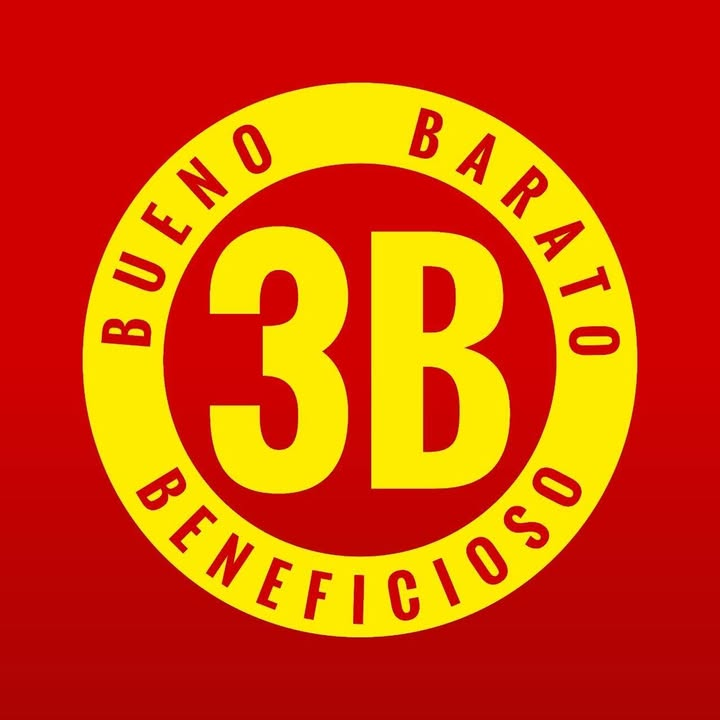

# Distribuidora 3B — especificación UX/UI

> Actualización de investigación: **2026-10-25**. Se completaron los datos recuperables y se conservaron pendientes y conflictos. Ver `RESUMEN-INVESTIGACION.md` y `assets/procedencia.json` dentro del paquete.

## Datos de la empresa

> Antecedentes de campaña y CSV: se conservan por trazabilidad. Los datos actualizados de la ficha siguiente prevalecen; las calificaciones y presupuestos históricos no fueron revalidados.

- `slug`: `distribuidora-3b-bahia-blanca`
- Posición en campaña: #6
- Fila CSV: 7
- Calificación Google: 4,6; 520 reseñas (CSV)
- Canal: WhatsApp; el correo del CSV se excluye del envío por decisión de campaña.
- Campaña: Distribuidora 3B; Bahía Blanca, Buenos Aires; +54 11 3626-8264; GDS, Brasil 977; Instagram https://www.instagram.com/mayorista3b/; Facebook https://www.facebook.com/p/Distribuidora-3B-100064159118978/
- Propuesta: portal B2B con catálogo, precios protegidos, pedido por WhatsApp y alta de comercios
- Oferta: $250.000 ARS único, cuotas posibles y $35.000 ARS mensuales; propuesta de NEZT, no precio verificado.

### Discrepancias y actualización

- Facebook publica un móvil de Bahía Blanca distinto del número de Buenos Aires del CSV; conservar ambos con su procedencia.
- El correo no era un dato nuevo: ya estaba en CSV. Excluirlo de la campaña no significa que no exista.
- El rubro se precisó con familias anunciadas por la propia página.
- Se conserva la exclusión de envío de campaña: no se contactó al negocio.

## Ficha del negocio

| Campo | Dato actualizado y procedencia |
|---|---|
| Nombre comercial | Distribuidora 3B |
| Razón social/CUIT | `{{legal_name}}`, `{{tax_id}}` — pendientes de constancia o comprobante fiscal; no se completan por homonimia. |
| Sector/rubro | Alimentos a granel: condimentos, harinas, hierbas, frutos secos, legumbres y productos de repostería anunciados. [B2] |
| Comprador objetivo | Compradores mayoristas y minoristas; segmentación concreta pendiente. [B3] |
| País y cobertura | Argentina. Envíos nacionales anunciados en una publicación; condiciones actuales `{{fulfillment_policy}}`. [B3] |
| Moneda e impuestos | `{{currency}}`, `{{tax_display_policy}}` pendientes. ARS es una propuesta para la maqueta argentina, no una política fiscal confirmada. |
| Idioma y tono | Español observado; `{{brand_tone}}` requiere decisión de marca. |
| Propuesta de valor | Venta de alimentos a granel por mayor y menor. Lema publicado: Bueno, Beneficioso y Barato. [B2, B3, B4] |
| CTA de la maqueta | Propuesta de diseño: «Consultar productos». `{{primary_cta}}` pendiente de aprobación; no es una decisión confirmada del negocio. |
| Modalidad comercial | Consultas por redes/contacto; compra web `{{purchase_mode}}` pendiente. |
| Precios | `{{price_visibility}}`: lista completa y condiciones actuales no confirmadas. |
| Cantidades y mínimos | Venta a granel anunciada; mínimos y múltiplos por producto `{{order_rules}}` pendientes. |
| Registro B2B | `{{account_approval_policy}}` — no se verificó flujo propio de aprobación. |
| Domicilio | Brasil 977, Bahía Blanca; corroborado en descripción pública. [B1] |
| Horarios | `{{opening_hours}}`: sin horario vigente de fuente propia confirmado. |
| Contactos y redes | Correo alimentosagranel3b@gmail.com (ya estaba en CSV); móvil publicado por Facebook +54 9 291 534-2363. Teléfono histórico CSV +54 11 3626-8264: no confirmado como contacto actual. Facebook e Instagram: https://www.facebook.com/p/Distribuidora-3B-100064159118978/ y https://www.instagram.com/mayorista3b/. [B1] |
| Crédito y permisos | `{{credit_policy}}`, `{{buyer_roles}}` — no publicados o no confirmados. |
| Catálogo, stock y sistemas | `{{data_sources}}` — no se obtuvo inventario exportable, precios vigentes ni sistema interno. |
| Fecha y nivel de evidencia | 2026-10-25; publicación propia, directorio o candidato indicados por campo. No se contactó a las empresas. |

## Recursos de marca a obtener

**Recuperado de la página vinculada al negocio**. La descarga no transforma una imagen raster en un archivo vectorial ni acredita derechos de publicación final.

| Recurso | Resultado |
|---|---|
| Imagen de perfil original | [perfil-facebook.jpg](assets/3b/perfil-facebook.jpg); 720 × 720 px. Fuente: https://www.facebook.com/p/Distribuidora-3B-100064159118978/ |
| Copia PNG de referencia | [logo-referencia.png](assets/3b/logo-referencia.png); conversión raster, sin vectorizar ni quitar fondos. |
| Logo SVG | `{{logo_svg}}` — no localizado; proporcionado por el usuario. |
| Paleta | Colores aproximados muestreados del raster: `#D00000`, `#FEED01`. **No son una paleta oficial**; `{{primary_palette_hex}}`, `{{secondary_palette_hex}}` pendientes de aprobación. |
| Tipografía | `{{brand_fonts}}` — no identificar la fuente del logo por apariencia. |
| Fotos de productos/local | `{{product_photos}}`, `{{business_photos}}` — no se recuperó un conjunto de fotos individuales de producto desde Facebook; los enlaces de publicaciones son referencias. |
| Eslogan | `{{tagline}}` — sin eslogan oficial confirmado; no convertir frases promocionales en uno. |
| Contactos | Datos publicados, fuentes y discrepancias en la ficha del negocio; `{{contact_details}}` representa la validación final. |
| Certificaciones y marcas | `{{verified_credentials}}` — no se completan por semejanza de logos o por referencias de terceros. |

Frase visible en perfil y gráfica: **Bueno, Beneficioso y Barato**; registrada como comunicación observada, sin atribuirle carácter de eslogan legal.

## Principios de UX/UI aplicados

Separar venta mayorista y minorista si cambian precios o cantidades; organizar por familias y marcas; mostrar cobertura y condiciones de envío; permitir consulta o pedido por WhatsApp sin afirmar confirmación; aplicar accesibilidad WCAG 2.2 AA: https://www.w3.org/TR/WCAG22/.

## Hallazgos de referencias

| ID | URL | Evidencia y límite |
|---|---|---|
| B1 | https://www.facebook.com/100064159118978/?locale=en_GB | Correo y móvil local de contacto en resultado público; misma página de Facebook del CSV. |
| B2 | https://www.facebook.com/100064159118978/photos/1524366143045342/ | Publicación enumera familias de productos a granel. |
| B3 | https://www.facebook.com/100064159118978/posts/distribuidora-mayorista-y-minorista-3bestamos-en-brasil-977-bahia-blancahacemos-/879138870901409/ | Anuncia venta mayorista/minorista y envíos nacionales; condiciones vigentes pendientes. |
| B4 | https://www.facebook.com/p/Distribuidora-3B-100064159118978/ | Imagen de perfil recuperada; lema Bueno, Beneficioso y Barato. |

Los resultados indexados de Facebook se usan cuando muestran explícitamente el dato; los metadatos públicos sirvieron para descargar la imagen de perfil. No se completaron compras, no se ingresó a cuentas y no se comprobó vigencia por llamada.

## Especificación de páginas

### Contrato de la maqueta y estructura común

- [ ] Usar datos confirmados o `{{...}}`.
- [ ] Hacer operables navegación, búsqueda, filtros, cantidades y validaciones.
- [ ] Representar estados de carga, vacío, error y éxito.
- [ ] Identificar simulaciones; ocultar precios no es autorización real.

Orden: aviso opcional → cabecera → navegación → contenido → pie. Componentes: nombre, buscador, categorías, cuenta, carrito/cotización, contacto y políticas.

### Inicio

Explicar venta mayorista/minorista y cobertura solo con evidencia; CTA `{{primary_cta}}`; no inventar marcas ni testimonios.

### Catálogo, categoría y búsqueda

Usar `{{category_attributes}}`; búsqueda por nombre/código, filtros combinables, estado vacío y conservación de posición.

### Detalle de producto

Mostrar `{{product_name}}`, `{{sku}}`, presentación, cantidad, disponibilidad y precio autorizado. Mínimos y múltiplos `{{minimum_quantity}}`, `{{quantity_step}}` pendientes.

### Carrito o cotización

Líneas editables, observaciones, entrega y validaciones; WhatsApp prepara códigos, cantidades y presentación.

### Finalización y confirmación — condicional

Solo con compra directa confirmada; revisar impuestos, entrega, pago y estado.

### Registro B2B, cuenta y pedido rápido

Condicionales: confirmar aprobación, listas, crédito, historial, recompra y pedido por código.

### Contacto y condiciones comerciales

Validar Brasil 977, teléfonos, horarios, envíos nacionales y políticas `{{commercial_policies}}`.

## Sistema de diseño

Tokens de marca sin aprobación: `{{color_brand_primary}}`, `{{color_brand_secondary}}`, `{{font_body}}`, `{{font_heading}}`. Los colores medidos en Recursos son muestras del raster, no valores corporativos oficiales.

Tokens de interfaz por definir al diseñar: `{{color_background}}`, `{{color_surface}}`, `{{color_text}}`, `{{space_scale}}`, `{{breakpoints}}`, `{{icon_set}}`, `{{image_fit}}`. Estos son decisiones de diseño, no datos que deban existir en internet.

Mantener estados de foco, carga, error, vacío, agotado y confirmación incierta. WCAG 2.2 AA exige objetivos de 24 × 24 CSS o sus excepciones; 44 × 44 CSS es un objetivo recomendado de diseño, no el mínimo AA.

## Preguntas abiertas

- Confirmar razón social, CUIT y condiciones fiscales con documentación del negocio.
- Validar teléfono, WhatsApp, horarios y domicilio cuando se indiquen como directorio, candidato o discrepancia.
- Proporcionar catálogo vigente con códigos, presentaciones, unidades, precios, impuestos y disponibilidad.
- Definir mínimos, bultos, escalas por volumen, pagos, reparto, retiro, devoluciones y crédito.
- Decidir registro B2B, visibilidad de precios y flujo de compra/cotización; las propuestas de campaña no prueban que existan.
- Aprobar identidad, paleta, tipografías, imágenes y alcance de la maqueta; entregar SVG si existe.

## Comprobación final

- [x] Revisada la ficha y cruzada con la fila original del CSV.
- [x] Fuentes, fecha, archivos de imagen y discrepancias documentados.
- [x] Separados datos publicados, candidatos, antecedentes y propuestas.
- [x] Pendientes comerciales y de marca conservados sin inventar datos.
- [ ] Confirmación directa de la empresa y aprobación de identidad.
- [ ] Funciones de maqueta probadas; esta entrega es documental.

