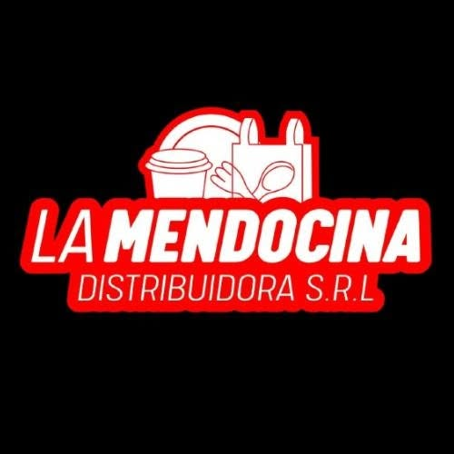

# Distribuidora La Mendocina SRL — especificación UX/UI

> Actualización de investigación: **2026-10-25**. Se completaron los datos recuperables y se conservaron pendientes y conflictos. Ver `RESUMEN-INVESTIGACION.md` y `assets/procedencia.json` dentro del paquete.

## Datos de la empresa

> Antecedentes de campaña y CSV: se conservan por trazabilidad. Los datos actualizados de la ficha siguiente prevalecen; las calificaciones y presupuestos históricos no fueron revalidados.

- `slug`: `distribuidora-la-mendocina-catamarca`
- Posición en campaña: #4
- Fila CSV: 5
- Calificación Google: 4,4; 552 reseñas (CSV)
- Canal: WhatsApp
- Campaña: Distribuidora La Mendocina SRL; San Fernando del Valle de Catamarca; +54 383 442-7473; Caseros 425; Google Maps: https://google.com/maps/?q=Distribuidora%20la%20Mendocina%20SRL%20Caseros%20425&ll=-28.466522,-65.78584&z=15
- Redes de campaña: no detectadas
- Oferta de campaña: $150.000 ARS único, cuotas posibles y $30.000 ARS mensuales; no es precio verificado de la empresa.

### Discrepancias y actualización

- Corregir el rubro de alimentos del CSV: se verificó fabricación/comercialización de packaging, envases y descartables.
- Se localizaron Facebook, Instagram, correo y WhatsApp; la ausencia de redes del CSV queda desactualizada.
- El teléfono de campaña y el WhatsApp publicado son números distintos; no intercambiarlos.
- No prometer envío gratuito universal: la nota describe logística propia regional, pero faltan condiciones comerciales vigentes.

## Ficha del negocio

| Campo | Dato actualizado y procedencia |
|---|---|
| Nombre comercial | Distribuidora La Mendocina SRL |
| Razón social/CUIT | `{{legal_name}}`, `{{tax_id}}` — pendientes de constancia o comprobante fiscal; no se completan por homonimia. |
| Sector/rubro | Fabricación de packaging y distribución de envases, descartables, frascos y artículos gastronómicos. [M1, M3] |
| Comprador objetivo | Empresas, comercios, gastronómicos y nuevos emprendimientos; venta mayorista y minorista anunciada. [M1, M3] |
| País y cobertura | Argentina. Facebook anuncia envíos a todo el país; costos, mínimos, plazos y rutas `{{fulfillment_policy}}` pendientes. [M1] |
| Moneda e impuestos | `{{currency}}`, `{{tax_display_policy}}` pendientes. ARS es una propuesta para la maqueta argentina, no una política fiscal confirmada. |
| Idioma y tono | Español observado; `{{brand_tone}}` requiere decisión de marca. |
| Propuesta de valor | Packaging de fabricación propia complementado con envases y descartables para distintos tamaños de negocio. [M3] |
| CTA de la maqueta | Propuesta de diseño: «Consultar productos». `{{primary_cta}}` pendiente de aprobación; no es una decisión confirmada del negocio. |
| Modalidad comercial | Consultas por redes y WhatsApp; transacción web `{{purchase_mode}}` pendiente. |
| Precios | `{{price_visibility}}`: no se confirmó lista vigente ni política de precios por comprador. |
| Cantidades y mínimos | `{{order_rules}}`: cantidades, personalización y mínimos de fabricación a confirmar. |
| Registro B2B | `{{account_approval_policy}}` — no se verificó flujo propio de aprobación. |
| Domicilio | Casa central Caseros 425, Catamarca. Otras sucursales y planta son mencionadas por fuentes locales; confirmar cuál corresponde a la maqueta. [M2] |
| Horarios | `{{opening_hours}}`: no se confirmó un horario propio vigente para Caseros 425. |
| Contactos y redes | Teléfono +54 383 442-7473; WhatsApp anunciado 3834-227529 (normalizado +54 383 422-7529); correo lamendocinasrl@hotmail.com. Facebook: https://www.facebook.com/p/Distribuidora-La-Mendocina-SRL-100063590063362/; Instagram: https://www.instagram.com/lamendocinasrl/. [M1, M3] |
| Crédito y permisos | `{{credit_policy}}`, `{{buyer_roles}}` — no publicados o no confirmados. |
| Catálogo, stock y sistemas | `{{data_sources}}` — no se obtuvo inventario exportable, precios vigentes ni sistema interno. |
| Fecha y nivel de evidencia | 2026-10-25; publicación propia, directorio o candidato indicados por campo. No se contactó a las empresas. |

## Recursos de marca a obtener

**Recuperado de la página vinculada al negocio**. La descarga no transforma una imagen raster en un archivo vectorial ni acredita derechos de publicación final.

| Recurso | Resultado |
|---|---|
| Imagen de perfil original | [perfil-facebook.jpg](assets/mendocina/perfil-facebook.jpg); 500 × 500 px. Fuente: https://www.facebook.com/p/Distribuidora-La-Mendocina-SRL-100063590063362/ |
| Copia PNG de referencia | [logo-referencia.png](assets/mendocina/logo-referencia.png); conversión raster, sin vectorizar ni quitar fondos. |
| Logo SVG | `{{logo_svg}}` — no localizado; proporcionado por el usuario. |
| Paleta | Colores aproximados muestreados del raster: `#F60203`, `#EABEBB`. **No son una paleta oficial**; `{{primary_palette_hex}}`, `{{secondary_palette_hex}}` pendientes de aprobación. |
| Tipografía | `{{brand_fonts}}` — no identificar la fuente del logo por apariencia. |
| Fotos de productos/local | `{{product_photos}}`, `{{business_photos}}` — no se recuperó un conjunto de fotos individuales de producto desde Facebook; los enlaces de publicaciones son referencias. |
| Eslogan | `{{tagline}}` — sin eslogan oficial confirmado; no convertir frases promocionales en uno. |
| Contactos | Datos publicados, fuentes y discrepancias en la ficha del negocio; `{{contact_details}}` representa la validación final. |
| Certificaciones y marcas | `{{verified_credentials}}` — no se completan por semejanza de logos o por referencias de terceros. |

## Principios de UX/UI aplicados

Organizar el catálogo por envases, descartables, bazar, limpieza y gastronomía; distinguir materiales, medidas y usos; mostrar unidad y presentación; informar entrega antes de confirmar; mantener búsqueda, filtros y CTA en móvil. Aplicar WCAG 2.2 AA: https://www.w3.org/TR/WCAG22/.

## Hallazgos de referencias

| ID | URL | Evidencia y límite |
|---|---|---|
| M1 | https://www.facebook.com/p/Distribuidora-La-Mendocina-SRL-100063590063362/ | Teléfono, correo, WhatsApp y anuncio de fabricación propia y envíos nacionales en resultados públicos; imagen de perfil recuperada. |
| M2 | https://www.extracatamarca.com/la-mendocina-consolida-su-planta-en-catamarca-y-amplia-la-produccion-de-packaging | Nota del 02/09/2026: casa central, planta, sucursales y fabricación. |
| M3 | https://federacioneconomicacatamarca.com.ar/produccion-desde-el-pantanillo-la-mendocina-mostro-en-la-expo-su-oferta-para-empresas-y-emprendedores/ | Federación Económica: fabricación, surtido, compradores y perfiles sociales. |
| M4 | https://miguiaargentina.com.ar/empresas/distribuidora-la-mendocina-srl.html | Directorio: envases, bazar y descartables; horarios y entrega deben reconfirmarse. |

Los resultados indexados de Facebook se usan cuando muestran explícitamente el dato; los metadatos públicos sirvieron para descargar la imagen de perfil. No se completaron compras, no se ingresó a cuentas y no se comprobó vigencia por llamada.

## Especificación de páginas

### Contrato de la maqueta y estructura común

- [ ] Usar datos confirmados o `{{...}}`.
- [ ] Hacer operables navegación, búsqueda, filtros, cantidades y validaciones.
- [ ] Representar carga, vacío, error y éxito.
- [ ] Identificar simulaciones y no tratar ocultación visual de precios como seguridad.

Orden: aviso opcional → cabecera → navegación → contenido → pie. Componentes: nombre, categorías, buscador, cuenta, carrito/cotización, contacto y políticas.

### Inicio

Proponer envases, descartables, bazar gastronómico y limpieza solo con el respaldo citado; CTA `{{primary_cta}}`; mostrar entrega solo con condiciones.

### Catálogo, categoría y búsqueda

Filtros `{{category_attributes}}` para material, medida, uso y presentación, pendientes de catálogo. Conservar filtros y posición al volver.

### Detalle de producto

`{{product_name}}`, `{{sku}}`, material, medidas, presentación, disponibilidad y precio autorizado. `{{minimum_quantity}}` y `{{quantity_step}}` pendientes.

### Carrito o cotización

Permitir cantidades, observaciones, entrega y cotización; mostrar transporte desconocido como pendiente y preparar WhatsApp sin afirmar envío confirmado.

### Finalización y confirmación — condicional

Solo si se confirma compra directa, impuestos, pagos y entrega.

### Registro B2B, cuenta y pedido rápido

Condicionales a política de aprobación, listas, crédito, historial, recompra y códigos.

### Contacto y condiciones comerciales

Mostrar Caseros 425 y horarios con fuente pública; validar teléfono, cobertura, devoluciones y `{{commercial_policies}}`.

## Sistema de diseño

Tokens de marca sin aprobación: `{{color_brand_primary}}`, `{{color_brand_secondary}}`, `{{font_body}}`, `{{font_heading}}`. Los colores medidos en Recursos son muestras del raster, no valores corporativos oficiales.

Tokens de interfaz por definir al diseñar: `{{color_background}}`, `{{color_surface}}`, `{{color_text}}`, `{{space_scale}}`, `{{breakpoints}}`, `{{icon_set}}`, `{{image_fit}}`. Estos son decisiones de diseño, no datos que deban existir en internet.

Mantener estados de foco, carga, error, vacío, agotado y confirmación incierta. WCAG 2.2 AA exige objetivos de 24 × 24 CSS o sus excepciones; 44 × 44 CSS es un objetivo recomendado de diseño, no el mínimo AA.

## Preguntas abiertas

- Confirmar razón social, CUIT y condiciones fiscales con documentación del negocio.
- Validar teléfono, WhatsApp, horarios y domicilio cuando se indiquen como directorio, candidato o discrepancia.
- Proporcionar catálogo vigente con códigos, presentaciones, unidades, precios, impuestos y disponibilidad.
- Definir mínimos, bultos, escalas por volumen, pagos, reparto, retiro, devoluciones y crédito.
- Decidir registro B2B, visibilidad de precios y flujo de compra/cotización; las propuestas de campaña no prueban que existan.
- Aprobar identidad, paleta, tipografías, imágenes y alcance de la maqueta; entregar SVG si existe.

## Comprobación final

- [x] Revisada la ficha y cruzada con la fila original del CSV.
- [x] Fuentes, fecha, archivos de imagen y discrepancias documentados.
- [x] Separados datos publicados, candidatos, antecedentes y propuestas.
- [x] Pendientes comerciales y de marca conservados sin inventar datos.
- [ ] Confirmación directa de la empresa y aprobación de identidad.
- [ ] Funciones de maqueta probadas; esta entrega es documental.

