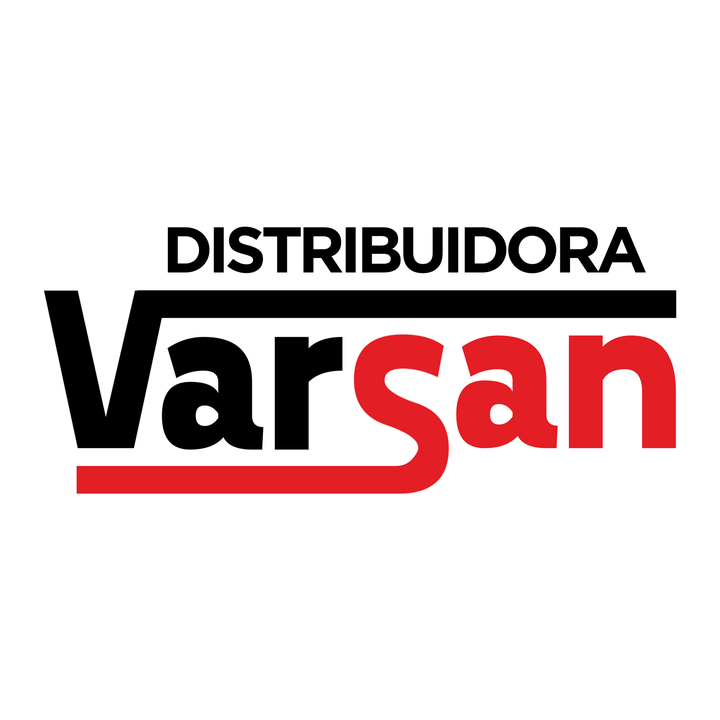

# Distribuidora Mayorista Varsan — especificación UX/UI

> Actualización de investigación: **2026-10-25**. Se completaron los datos recuperables y se conservaron pendientes y conflictos. Ver `RESUMEN-INVESTIGACION.md` y `assets/procedencia.json` dentro del paquete.

## Datos de la empresa

> Antecedentes de campaña y CSV: se conservan por trazabilidad. Los datos actualizados de la ficha siguiente prevalecen; las calificaciones y presupuestos históricos no fueron revalidados.

- `slug`: `distribuidora-mayorista-varsan-santiago-del-estero`
- Posición en campaña: #3
- Fila CSV: 4
- Calificación Google: 4,1; 685 reseñas (CSV)
- Canal: WhatsApp
- Campaña: Distribuidora Mayorista Varsan; Santiago del Estero (Capital); +54 385 592-0550; Av. Solís Oeste 1096; Google Maps: https://google.com/maps/?q=DISTRIBUIDORA%20MAYORISTA%20VARSAN%20Av.%20Sol%C3%ADs%20Oeste%201096&ll=-27.824583,-64.257095&z=15
- Redes de campaña: no detectadas
- Oferta de campaña: $150.000 ARS único, cuotas posibles y $30.000 ARS mensuales; propuesta de NEZT, no precio de la empresa.

### Discrepancias y actualización

- La coincidencia del teléfono y la dirección histórica vincula el perfil con el negocio; no demuestra que 1096 siga vigente.
- No resolver automáticamente 1096 frente a 992 como mudanza o sucursal: ambas interpretaciones requieren confirmación.
- El dominio distribuidoramayoristavarsan.com figura como histórico en TodosNegocios, no como tienda activa.
- El surtido comprobable es más específico que «consumo masivo»: bebidas y anexo de cigarrillos.

## Ficha del negocio

| Campo | Dato actualizado y procedencia |
|---|---|
| Nombre comercial | Distribuidora Mayorista Varsan |
| Razón social/CUIT | `{{legal_name}}`, `{{tax_id}}` — pendientes de constancia o comprobante fiscal; no se completan por homonimia. |
| Sector/rubro | Bebidas por mayor y menor, con anexo de cigarrillos anunciado en la descripción de Facebook. [V1] |
| Comprador objetivo | Compradores mayoristas y minoristas; segmentos concretos `{{buyer_type}}` pendientes. [V1] |
| País y cobertura | Argentina. Santiago del Estero; Facebook menciona envíos sin cobertura detallada. `{{service_area}}`, `{{fulfillment_policy}}`. [V1] |
| Moneda e impuestos | `{{currency}}`, `{{tax_display_policy}}` pendientes. ARS es una propuesta para la maqueta argentina, no una política fiscal confirmada. |
| Idioma y tono | Español observado; `{{brand_tone}}` requiere decisión de marca. |
| Propuesta de valor | Venta de bebidas al por mayor y menor con ofertas difundidas en Facebook. [V1] |
| CTA de la maqueta | Propuesta de diseño: «Consultar productos». `{{primary_cta}}` pendiente de aprobación; no es una decisión confirmada del negocio. |
| Modalidad comercial | Venta presencial y consultas; pedido digital `{{purchase_mode}}` pendiente. |
| Precios | Ofertas en publicaciones; lista vigente y protección de precios `{{price_visibility}}` pendientes. |
| Cantidades y mínimos | `{{order_rules}}`: mínimos, bultos y múltiplos pendientes. |
| Registro B2B | `{{account_approval_policy}}` — no se verificó flujo propio de aprobación. |
| Domicilio | Av. Solís Oeste 1096 en directorios y publicaciones anteriores; publicaciones del mismo perfil anuncian Av. Solís 992. Domicilio vigente `{{confirmed_address}}`: pendiente. [V2, V3, V4] |
| Horarios | Directorio: lunes a sábados 08:00–13:00 y 17:00–22:00; domingos 09:00–13:00. Confirmar antes de publicar. [V2, V5] |
| Contactos y redes | Teléfono coincidente con una publicación propia: +54 385 592-0550. Directorios añaden +54 385 573-3858. No se verificó WhatsApp activo. Facebook: https://www.facebook.com/distribuidoravarsan.ok/. [V1, V2, V3] |
| Crédito y permisos | `{{credit_policy}}`, `{{buyer_roles}}` — no publicados o no confirmados. |
| Catálogo, stock y sistemas | `{{data_sources}}` — no se obtuvo inventario exportable, precios vigentes ni sistema interno. |
| Fecha y nivel de evidencia | 2026-10-25; publicación propia, directorio o candidato indicados por campo. No se contactó a las empresas. |

## Recursos de marca a obtener

**Recuperado de la página vinculada al negocio**. La descarga no transforma una imagen raster en un archivo vectorial ni acredita derechos de publicación final.

| Recurso | Resultado |
|---|---|
| Imagen de perfil original | [perfil-facebook.png](assets/varsan/perfil-facebook.png); 720 × 720 px. Fuente: https://www.facebook.com/distribuidoravarsan.ok/ |
| Copia PNG de referencia | [logo-referencia.png](assets/varsan/logo-referencia.png); conversión raster, sin vectorizar ni quitar fondos. |
| Logo SVG | `{{logo_svg}}` — no localizado; proporcionado por el usuario. |
| Paleta | Colores aproximados muestreados del raster: `#E31E24`, `#E2181E`. **No son una paleta oficial**; `{{primary_palette_hex}}`, `{{secondary_palette_hex}}` pendientes de aprobación. |
| Tipografía | `{{brand_fonts}}` — no identificar la fuente del logo por apariencia. |
| Fotos de productos/local | `{{product_photos}}`, `{{business_photos}}` — no se recuperó un conjunto de fotos individuales de producto desde Facebook; los enlaces de publicaciones son referencias. |
| Eslogan | `{{tagline}}` — sin eslogan oficial confirmado; no convertir frases promocionales en uno. |
| Contactos | Datos publicados, fuentes y discrepancias en la ficha del negocio; `{{contact_details}}` representa la validación final. |
| Certificaciones y marcas | `{{verified_credentials}}` — no se completan por semejanza de logos o por referencias de terceros. |

## Principios de UX/UI aplicados

Priorizar descubrimiento por familias y búsqueda; permitir comparar presentación, unidad, disponibilidad y precio autorizado; explicar mínimos antes de confirmar; conservar cantidades y errores; adaptar filtros a móvil. Aplicar WCAG 2.2 AA: https://www.w3.org/TR/WCAG22/. No inferir alimentos, colores, precios, crédito o catálogo real sin confirmación.

## Hallazgos de referencias

| ID | URL | Evidencia y límite |
|---|---|---|
| V1 | https://www.facebook.com/distribuidoravarsan.ok/ | Descripción pública de bebidas y cigarrillos; imagen de perfil recuperada. |
| V2 | https://ar.todosnegocios.com/distribuidora-mayorista-varsan-0385-592-0550 | Dos teléfonos, dirección 1096 y horarios; cataloga el dominio como histórico. |
| V3 | https://www.facebook.com/distribuidoravarsan.ok/posts/se%C3%B1ores-clientes-distribuidora-varsan-les-ofrece-las-mejores-ofertas-y-promos-pa/930118592476947/ | Publicación con Solís 1096 y teléfono 0385 15-592-0550. |
| V4 | https://www.facebook.com/distribuidoravarsan.ok/posts/llegaron-las-ofertas-imperdibles-a-distribuidora-varsan-ll%C3%A9gate-por-av-sol%C3%ADs-992/1340005884821547/ | Publicación del mismo perfil con dirección Solís 992. |
| V5 | https://www.cylex.com.ar/santiago-del-estero/distribuidora-mayorista-varsan-11362590.html | Corrobora teléfono alternativo y horarios; fuente secundaria. |

Los resultados indexados de Facebook se usan cuando muestran explícitamente el dato; los metadatos públicos sirvieron para descargar la imagen de perfil. No se completaron compras, no se ingresó a cuentas y no se comprobó vigencia por llamada.

## Especificación de páginas

### Contrato de la maqueta y estructura común

- [ ] Datos confirmados o `{{...}}`.
- [ ] Navegación, búsqueda, filtros, cantidades y validaciones operables.
- [ ] Estados de carga, vacío, error y éxito.
- [ ] Simulaciones identificadas; precios ocultos no tratados como seguridad.

Orden: aviso opcional → cabecera → navegación → contenido → pie. Componentes: nombre, buscador, categorías, cuenta, carrito/cotización, contacto y condiciones.

### Inicio

Usar `{{value_proposition}}`, `{{primary_cta}}`, categorías y contacto solo después de confirmar rubro, comprador y cobertura.

### Catálogo, categoría y búsqueda

Definir `{{category_attributes}}`; admitir nombre y código, filtros combinables, limpieza individual, estado vacío y recuperación de posición.

### Detalle de producto

Usar `{{product_name}}`, `{{sku}}`, variantes, presentación, disponibilidad y precio autorizado. `{{minimum_quantity}}`, `{{quantity_step}}` y agotados pendientes.

### Carrito o cotización

Editar cantidades, validar mínimos, distinguir pendiente de cero y preparar pedido de WhatsApp con códigos; no confirmar envío.

### Finalización y confirmación — condicional

Solo con compra directa confirmada; revisar artículos, impuestos, entrega, pago, referencia y estado.

### Registro B2B, cuenta y pedido rápido

Condicionales. Confirmar aprobación, precios, listas, crédito, historial, recompra, códigos y carga masiva antes de incluirlos.

### Contacto y condiciones comerciales

Usar teléfono y dirección del CSV solo como datos de campaña hasta validarlos. Mantener `{{commercial_policies}}` pendiente.

## Sistema de diseño

Tokens de marca sin aprobación: `{{color_brand_primary}}`, `{{color_brand_secondary}}`, `{{font_body}}`, `{{font_heading}}`. Los colores medidos en Recursos son muestras del raster, no valores corporativos oficiales.

Tokens de interfaz por definir al diseñar: `{{color_background}}`, `{{color_surface}}`, `{{color_text}}`, `{{space_scale}}`, `{{breakpoints}}`, `{{icon_set}}`, `{{image_fit}}`. Estos son decisiones de diseño, no datos que deban existir en internet.

Mantener estados de foco, carga, error, vacío, agotado y confirmación incierta. WCAG 2.2 AA exige objetivos de 24 × 24 CSS o sus excepciones; 44 × 44 CSS es un objetivo recomendado de diseño, no el mínimo AA.

## Preguntas abiertas

- Confirmar razón social, CUIT y condiciones fiscales con documentación del negocio.
- Validar teléfono, WhatsApp, horarios y domicilio cuando se indiquen como directorio, candidato o discrepancia.
- Proporcionar catálogo vigente con códigos, presentaciones, unidades, precios, impuestos y disponibilidad.
- Definir mínimos, bultos, escalas por volumen, pagos, reparto, retiro, devoluciones y crédito.
- Decidir registro B2B, visibilidad de precios y flujo de compra/cotización; las propuestas de campaña no prueban que existan.
- Aprobar identidad, paleta, tipografías, imágenes y alcance de la maqueta; entregar SVG si existe.
- Resolver Solís Oeste 1096 frente a Solís 992 antes de publicar mapa o indicaciones.

## Comprobación final

- [x] Revisada la ficha y cruzada con la fila original del CSV.
- [x] Fuentes, fecha, archivos de imagen y discrepancias documentados.
- [x] Separados datos publicados, candidatos, antecedentes y propuestas.
- [x] Pendientes comerciales y de marca conservados sin inventar datos.
- [ ] Confirmación directa de la empresa y aprobación de identidad.
- [ ] Funciones de maqueta probadas; esta entrega es documental.

