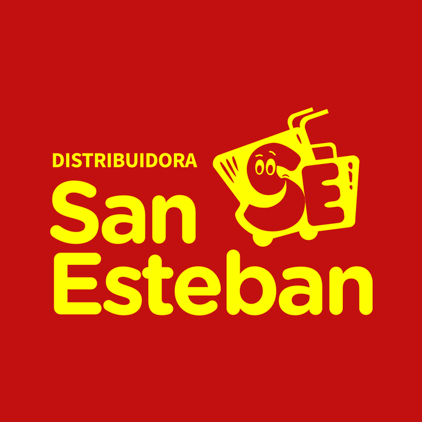

# Distribuidora San Esteban — especificación UX/UI

> Actualización de investigación: **2026-10-25**. Se completaron los datos recuperables y se conservaron pendientes y conflictos. Ver `RESUMEN-INVESTIGACION.md` y `assets/procedencia.json` dentro del paquete.

## Datos de la empresa

> Antecedentes de campaña y CSV: se conservan por trazabilidad. Los datos actualizados de la ficha siguiente prevalecen; las calificaciones y presupuestos históricos no fueron revalidados.

- `slug`: `distribuidora-san-esteban-santiago-del-estero`
- Posición en campaña: #8
- Fila CSV: 9
- Calificación Google: 4,3; 489 reseñas (CSV)
- Canal: WhatsApp
- Campaña: Distribuidora San Esteban; Santiago del Estero (Capital); +54 385 418-1036; Av. Solís Oeste 1085; Instagram https://www.instagram.com/distribuidorasanesteban/; Linktree https://linktr.ee/distribuidorasanesteban
- Propuesta: portal B2B con catálogo, precios protegidos, pedido por WhatsApp y alta de comercios
- Oferta: $150.000 ARS único, cuotas posibles y $30.000 ARS mensuales; propuesta de NEZT.

### Discrepancias y actualización

- El teléfono coincide con CSV y Facebook.
- 1085 tiene respaldo de publicación propia y proveedor; 1130 se conserva como discrepancia pendiente.
- El Linktree no accesible no demuestra inexistencia del grupo de WhatsApp; no se extrajo enlace de invitación.
- No se verificaron lista protegida, crédito ni registro B2B.

## Ficha del negocio

| Campo | Dato actualizado y procedencia |
|---|---|
| Nombre comercial | Distribuidora San Esteban |
| Razón social/CUIT | `{{legal_name}}`, `{{tax_id}}` — pendientes de constancia o comprobante fiscal; no se completan por homonimia. |
| Sector/rubro | Supermercado mayorista de consumo masivo según descripción propia. [N1] |
| Comprador objetivo | Compradores de supermercado mayorista; tipos de cuenta `{{buyer_type}}` pendientes. |
| País y cobertura | Argentina. Santiago del Estero; entrega y cobertura `{{service_area}}`, `{{fulfillment_policy}}` pendientes. |
| Moneda e impuestos | `{{currency}}`, `{{tax_display_policy}}` pendientes. ARS es una propuesta para la maqueta argentina, no una política fiscal confirmada. |
| Idioma y tono | Español observado; `{{brand_tone}}` requiere decisión de marca. |
| Propuesta de valor | Supermercado mayorista con comunicación pública de productos y ofertas. [N1] |
| CTA de la maqueta | Propuesta de diseño: «Consultar productos». `{{primary_cta}}` pendiente de aprobación; no es una decisión confirmada del negocio. |
| Modalidad comercial | Atención presencial y redes; flujo digital `{{purchase_mode}}` pendiente. |
| Precios | Ofertas públicas; catálogo y lista completa `{{price_visibility}}` pendientes. |
| Cantidades y mínimos | `{{order_rules}}`: no se confirmaron mínimos ni múltiplos. |
| Registro B2B | `{{account_approval_policy}}` — no se verificó flujo propio de aprobación. |
| Domicilio | Av. Solís Oeste 1085, Santiago del Estero: coincide con publicación propia y mapa de un proveedor. Otra ficha indica 1130; confirmar si es sucursal o referencia desactualizada. [N2, N3] |
| Horarios | `{{opening_hours}}`: no se consolidó horario vigente a partir de avisos especiales. |
| Contactos y redes | Teléfono público +54 385 418-1036. Facebook: https://www.facebook.com/SanEstebanSrl/. Instagram de origen: https://www.instagram.com/distribuidorasanesteban/; Linktree https://linktr.ee/distribuidorasanesteban no pudo recuperarse. No se confirmó WhatsApp activo. [N1] |
| Crédito y permisos | `{{credit_policy}}`, `{{buyer_roles}}` — no publicados o no confirmados. |
| Catálogo, stock y sistemas | `{{data_sources}}` — no se obtuvo inventario exportable, precios vigentes ni sistema interno. |
| Fecha y nivel de evidencia | 2026-10-25; publicación propia, directorio o candidato indicados por campo. No se contactó a las empresas. |

## Recursos de marca a obtener

**Recuperado de la página vinculada al negocio**. La descarga no transforma una imagen raster en un archivo vectorial ni acredita derechos de publicación final.

| Recurso | Resultado |
|---|---|
| Imagen de perfil original | [perfil-facebook.png](assets/sanesteban/perfil-facebook.png); 720 × 720 px. Fuente: https://www.facebook.com/SanEstebanSrl/ |
| Copia PNG de referencia | [logo-referencia.png](assets/sanesteban/logo-referencia.png); conversión raster, sin vectorizar ni quitar fondos. |
| Logo SVG | `{{logo_svg}}` — no localizado; proporcionado por el usuario. |
| Paleta | Colores aproximados muestreados del raster: `#C21010`, `#FEFF00`. **No son una paleta oficial**; `{{primary_palette_hex}}`, `{{secondary_palette_hex}}` pendientes de aprobación. |
| Tipografía | `{{brand_fonts}}` — no identificar la fuente del logo por apariencia. |
| Fotos de productos/local | `{{product_photos}}`, `{{business_photos}}` — no se recuperó un conjunto de fotos individuales de producto desde Facebook; los enlaces de publicaciones son referencias. |
| Eslogan | `{{tagline}}` — sin eslogan oficial confirmado; no convertir frases promocionales en uno. |
| Contactos | Datos publicados, fuentes y discrepancias en la ficha del negocio; `{{contact_details}}` representa la validación final. |
| Certificaciones y marcas | `{{verified_credentials}}` — no se completan por semejanza de logos o por referencias de terceros. |

## Principios de UX/UI aplicados

Centralizar canales sin eliminar WhatsApp; organizar surtido por familias y marcas; mantener precios, unidades y vigencia; advertir domicilio pendiente; permitir recompra solo con evidencia; aplicar WCAG 2.2 AA: https://www.w3.org/TR/WCAG22/.

## Hallazgos de referencias

| ID | URL | Evidencia y límite |
|---|---|---|
| N1 | https://www.facebook.com/SanEstebanSrl/ | Descripción propia de supermercado mayorista, teléfono e imagen de perfil. |
| N2 | https://www.facebook.com/SanEstebanSrl/posts/-estamos-buscando-cajero-nos-encontramos-en-la-b%C3%BAsqueda-de-cajero-con-experienci/1129822465833643/ | Publicación del negocio con Solís Oeste 1085. |
| N3 | https://yerbaterahojaverde.com/en/sales-map/ | Proveedor identifica Distribuidora San Esteban SRL en Solís Oeste 1085. |
| N4 | https://www.atlashipermayorista.com.ar/supermercado/distribuidora-san-esteban-mayorista/ | Ficha de terceros con domicilio divergente 1130; no usar para reemplazo automático. |

Los resultados indexados de Facebook se usan cuando muestran explícitamente el dato; los metadatos públicos sirvieron para descargar la imagen de perfil. No se completaron compras, no se ingresó a cuentas y no se comprobó vigencia por llamada.

## Especificación de páginas

### Contrato de la maqueta y estructura común

- [ ] Usar datos confirmados o `{{...}}`.
- [ ] Operar navegación, búsqueda, filtros, cantidades y validaciones.
- [ ] Representar carga, vacío, error y éxito.
- [ ] Identificar simulaciones y no tratar ocultación visual de precios como seguridad.

Orden: aviso opcional → cabecera → navegación → contenido → pie.

### Inicio

Presentar supermercado/mayorista solo tras confirmar el posicionamiento; CTA `{{primary_cta}}`; mostrar canales y cobertura verificados.

### Catálogo, categoría y búsqueda

`{{category_attributes}}` pendiente; filtros por familia, marca, presentación y vigencia si el catálogo los confirma.

### Detalle de producto

`{{product_name}}`, `{{sku}}`, presentación, disponibilidad, precio, `{{minimum_quantity}}` y `{{quantity_step}}` pendientes.

### Carrito o cotización

Editar cantidades, validar condiciones y preparar WhatsApp con códigos; distinguir solicitud pendiente de pedido confirmado.

### Finalización y confirmación — condicional

Incluir solo con compra directa y políticas verificadas.

### Registro B2B, cuenta y pedido rápido

Condicionales a aprobación, precios, listas, crédito, recompra y códigos.

### Contacto y condiciones comerciales

Resolver domicilio, teléfono, horarios, retiro, cobertura y `{{commercial_policies}}` antes de publicar.

## Sistema de diseño

Tokens de marca sin aprobación: `{{color_brand_primary}}`, `{{color_brand_secondary}}`, `{{font_body}}`, `{{font_heading}}`. Los colores medidos en Recursos son muestras del raster, no valores corporativos oficiales.

Tokens de interfaz por definir al diseñar: `{{color_background}}`, `{{color_surface}}`, `{{color_text}}`, `{{space_scale}}`, `{{breakpoints}}`, `{{icon_set}}`, `{{image_fit}}`. Estos son decisiones de diseño, no datos que deban existir en internet.

Mantener estados de foco, carga, error, vacío, agotado y confirmación incierta. WCAG 2.2 AA exige objetivos de 24 × 24 CSS o sus excepciones; 44 × 44 CSS es un objetivo recomendado de diseño, no el mínimo AA.

## Preguntas abiertas

- Confirmar razón social, CUIT y condiciones fiscales con documentación del negocio.
- Validar teléfono, WhatsApp, horarios y domicilio cuando se indiquen como directorio, candidato o discrepancia.
- Proporcionar catálogo vigente con códigos, presentaciones, unidades, precios, impuestos y disponibilidad.
- Definir mínimos, bultos, escalas por volumen, pagos, reparto, retiro, devoluciones y crédito.
- Decidir registro B2B, visibilidad de precios y flujo de compra/cotización; las propuestas de campaña no prueban que existan.
- Aprobar identidad, paleta, tipografías, imágenes y alcance de la maqueta; entregar SVG si existe.

## Comprobación final

- [x] Revisada la ficha y cruzada con la fila original del CSV.
- [x] Fuentes, fecha, archivos de imagen y discrepancias documentados.
- [x] Separados datos publicados, candidatos, antecedentes y propuestas.
- [x] Pendientes comerciales y de marca conservados sin inventar datos.
- [ ] Confirmación directa de la empresa y aprobación de identidad.
- [ ] Funciones de maqueta probadas; esta entrega es documental.

