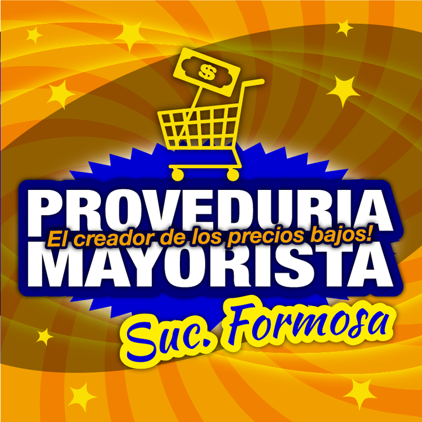

# Proveeduría Mayorista — especificación UX/UI

> Actualización de investigación: **2026-10-25**. Se completaron los datos recuperables y se conservaron pendientes y conflictos. Ver `RESUMEN-INVESTIGACION.md` y `assets/procedencia.json` dentro del paquete.

## Datos de la empresa

> Antecedentes de campaña y CSV: se conservan por trazabilidad. Los datos actualizados de la ficha siguiente prevalecen; las calificaciones y presupuestos históricos no fueron revalidados.

- `slug`: `proveeduria-mayorista-formosa`
- Posición en campaña: #7
- Fila CSV: 8
- Calificación Google: 4,1; 498 reseñas (CSV)
- Canal: WhatsApp
- Campaña: Proveeduría Mayorista; Formosa (Capital); teléfono s/d; Pedro Bonaccio 1799; Google Maps: https://google.com/maps/?q=PROVEDURIA%20MAYORISTA%20Pedro%20Bonaccio%201799&ll=-26.160769,-58.193027&z=15
- Redes: no detectadas
- Propuesta: ofertas semanales, lista de precios para comerciantes y retiro anticipado
- Oferta: $150.000 ARS único, cuotas posibles y $30.000 ARS mensuales; propuesta de NEZT.

### Discrepancias y actualización

- Se recuperó la ficha antes inaccesible: domicilio y horarios son datos de directorio, no confirmación directa del dueño.
- Facebook e Instagram son candidatos: nombre y ciudad no bastan para confirmar que corresponden a Bonaccio 1799.
- El logo candidato se guarda aparte y no debe usarse como identidad confirmada.
- No copiar teléfonos de empresas cercanas del directorio ni del medio Cuchermercados.

## Ficha del negocio

| Campo | Dato actualizado y procedencia |
|---|---|
| Nombre comercial | Proveeduría Mayorista |
| Razón social/CUIT | `{{legal_name}}`, `{{tax_id}}` — pendientes de constancia o comprobante fiscal; no se completan por homonimia. |
| Sector/rubro | Tienda de alimentación según ficha coincidente en Pedro Bonaccio 1799. El rubro mayorista familiar de la página candidata no se atribuye aún al mismo local. [F1, F2] |
| Comprador objetivo | `{{buyer_type}}`: pendiente para el local del CSV. La página candidata menciona familias y pequeños comercios, sin atribución definitiva. |
| País y cobertura | Argentina. Formosa; reparto, retiro anticipado y cobertura `{{fulfillment_policy}}`, `{{service_area}}` pendientes. |
| Moneda e impuestos | `{{currency}}`, `{{tax_display_policy}}` pendientes. ARS es una propuesta para la maqueta argentina, no una política fiscal confirmada. |
| Idioma y tono | Español observado; `{{brand_tone}}` requiere decisión de marca. |
| Propuesta de valor | `{{value_proposition}}`: pendiente de confirmar con identidad resuelta. |
| CTA de la maqueta | Propuesta de diseño: «Consultar productos». `{{primary_cta}}` pendiente de aprobación; no es una decisión confirmada del negocio. |
| Modalidad comercial | `{{purchase_mode}}`: no se confirmó pedido digital. |
| Precios | `{{price_visibility}}`: no confirmado. |
| Cantidades y mínimos | `{{order_rules}}`: no confirmado. |
| Registro B2B | `{{account_approval_policy}}` — no se verificó flujo propio de aprobación. |
| Domicilio | Pedro Bonaccio 1799, Formosa; corroborado en Cylex. [F1] |
| Horarios | Directorio: lunes 08:00–13:00 y 16:00–19:00; martes a viernes 08:00–13:00 y 16:00–18:00; sábados 08:00–12:00; domingos cerrado. Confirmar. [F1] |
| Contactos y redes | Teléfono `{{phone}}`, WhatsApp `{{whatsapp}}` y correo `{{email}}` no confirmados. Página candidata: https://www.facebook.com/ProveduriaMayoristaFormosa/; Instagram candidato: https://www.instagram.com/proveduriamayoristaformosa/. Falta enlace comprobable con el domicilio del CSV. [F2, F3] |
| Crédito y permisos | `{{credit_policy}}`, `{{buyer_roles}}` — no publicados o no confirmados. |
| Catálogo, stock y sistemas | `{{data_sources}}` — no se obtuvo inventario exportable, precios vigentes ni sistema interno. |
| Fecha y nivel de evidencia | 2026-10-25; publicación propia, directorio o candidato indicados por campo. No se contactó a las empresas. |

## Recursos de marca a obtener

**Candidato, identidad pendiente de vincular con Bonaccio 1799**. La descarga no transforma una imagen raster en un archivo vectorial ni acredita derechos de publicación final.

| Recurso | Resultado |
|---|---|
| Imagen de perfil original | [perfil-facebook.png](assets/candidatos/formosa/perfil-facebook.png); 720 × 720 px. Fuente: https://www.facebook.com/ProveduriaMayoristaFormosa/ |
| Copia PNG de referencia | [logo-referencia.png](assets/candidatos/formosa/logo-referencia.png); conversión raster, sin vectorizar ni quitar fondos. |
| Logo SVG | `{{logo_svg}}` — no localizado; proporcionado por el usuario. |
| Paleta | Colores aproximados muestreados del raster: `#915D00`, `#F19F00`. **No son una paleta oficial**; `{{primary_palette_hex}}`, `{{secondary_palette_hex}}` pendientes de aprobación. |
| Tipografía | `{{brand_fonts}}` — no identificar la fuente del logo por apariencia. |
| Fotos de productos/local | `{{product_photos}}`, `{{business_photos}}` — no se recuperó un conjunto de fotos individuales de producto desde Facebook; los enlaces de publicaciones son referencias. |
| Eslogan | `{{tagline}}` — sin eslogan oficial confirmado; no convertir frases promocionales en uno. |
| Contactos | Datos publicados, fuentes y discrepancias en la ficha del negocio; `{{contact_details}}` representa la validación final. |
| Certificaciones y marcas | `{{verified_credentials}}` — no se completan por semejanza de logos o por referencias de terceros. |

No utilizar esta imagen ni sus colores en una maqueta identificada como el local del CSV hasta resolver la identidad.

## Principios de UX/UI aplicados

No asumir “ofertas semanales” hasta confirmarlo. Si el rubro es autoservicio, usar categorías y vigencia, mostrar unidad y precio, explicar retiro y mínimos, conservar el pedido y aplicar WCAG 2.2 AA: https://www.w3.org/TR/WCAG22/.

## Hallazgos de referencias

| ID | URL | Evidencia y límite |
|---|---|---|
| F1 | https://www.cylex.com.ar/formosa/proveeduria-mayorista-11584966.html | Dirección, categoría y horarios; no publica teléfono recuperable. |
| F2 | https://www.facebook.com/ProveduriaMayoristaFormosa/ | Página candidata de nombre y ciudad compatibles; imagen descargada, sin vínculo con Bonaccio 1799 confirmado. |
| F3 | https://www.instagram.com/proveduriamayoristaformosa/ | Perfil candidato con posicionamiento para familias y pequeños comercios; atribución pendiente. |

Los resultados indexados de Facebook se usan cuando muestran explícitamente el dato; los metadatos públicos sirvieron para descargar la imagen de perfil. No se completaron compras, no se ingresó a cuentas y no se comprobó vigencia por llamada.

## Especificación de páginas

### Contrato de la maqueta y estructura común

- [ ] Usar valores confirmados o `{{...}}`.
- [ ] Operar navegación, búsqueda, filtros, cantidades y validaciones.
- [ ] Representar carga, vacío, error y éxito.
- [ ] Identificar simulaciones y no tratar ocultación de precios como seguridad.

Orden: aviso opcional → cabecera → navegación → contenido → pie.

### Inicio

Usar `{{value_proposition}}`, `{{primary_cta}}`, categorías y contacto solo después de confirmar negocio y comprador.

### Catálogo, categoría y búsqueda

Definir `{{category_attributes}}`; conservar filtros, consulta y posición, con estado sin resultados recuperable.

### Detalle de producto

`{{product_name}}`, `{{sku}}`, presentación, disponibilidad, precio, `{{minimum_quantity}}` y `{{quantity_step}}` pendientes.

### Carrito o cotización

Editar cantidades, validar mínimos, mostrar pendientes y preparar WhatsApp sin declarar envío confirmado.

### Finalización y confirmación — condicional

Solo si se confirma compra directa, pago, impuestos y logística.

### Registro B2B, cuenta y pedido rápido

Condicionales a políticas de aprobación, precios, crédito, listas, historial y códigos.

### Contacto y condiciones comerciales

Validar teléfono, dirección, horarios, cobertura, retiro y `{{commercial_policies}}`; incluir mapa con alternativa textual.

## Sistema de diseño

Tokens de marca sin aprobación: `{{color_brand_primary}}`, `{{color_brand_secondary}}`, `{{font_body}}`, `{{font_heading}}`. Los colores medidos en Recursos son muestras del raster, no valores corporativos oficiales.

Tokens de interfaz por definir al diseñar: `{{color_background}}`, `{{color_surface}}`, `{{color_text}}`, `{{space_scale}}`, `{{breakpoints}}`, `{{icon_set}}`, `{{image_fit}}`. Estos son decisiones de diseño, no datos que deban existir en internet.

Mantener estados de foco, carga, error, vacío, agotado y confirmación incierta. WCAG 2.2 AA exige objetivos de 24 × 24 CSS o sus excepciones; 44 × 44 CSS es un objetivo recomendado de diseño, no el mínimo AA.

## Preguntas abiertas

- Confirmar razón social, CUIT y condiciones fiscales con documentación del negocio.
- Validar teléfono, WhatsApp, horarios y domicilio cuando se indiquen como directorio, candidato o discrepancia.
- Proporcionar catálogo vigente con códigos, presentaciones, unidades, precios, impuestos y disponibilidad.
- Definir mínimos, bultos, escalas por volumen, pagos, reparto, retiro, devoluciones y crédito.
- Decidir registro B2B, visibilidad de precios y flujo de compra/cotización; las propuestas de campaña no prueban que existan.
- Aprobar identidad, paleta, tipografías, imágenes y alcance de la maqueta; entregar SVG si existe.
- Confirmar si Proveduría Mayorista Formosa en Facebook es el mismo negocio de Pedro Bonaccio 1799; teléfono y correo siguen faltando.

## Comprobación final

- [x] Revisada la ficha y cruzada con la fila original del CSV.
- [x] Fuentes, fecha, archivos de imagen y discrepancias documentados.
- [x] Separados datos publicados, candidatos, antecedentes y propuestas.
- [x] Pendientes comerciales y de marca conservados sin inventar datos.
- [ ] Confirmación directa de la empresa y aprobación de identidad.
- [ ] Funciones de maqueta probadas; esta entrega es documental.

