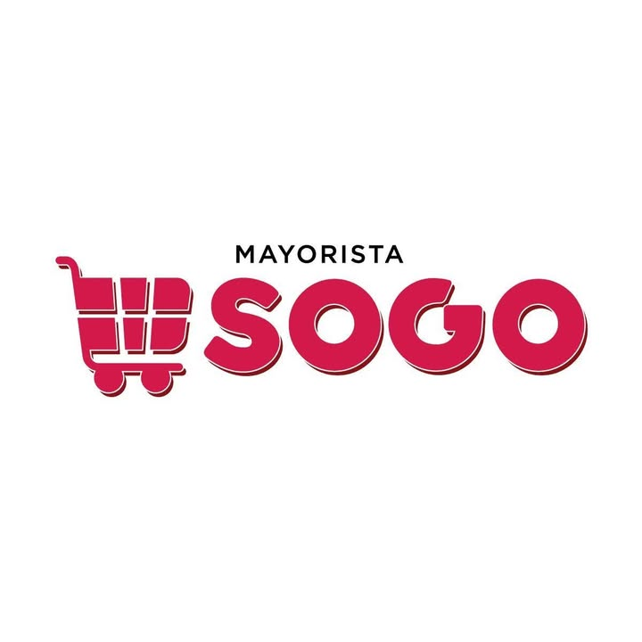

# Sogo Mayorista — especificación UX/UI

> Actualización de investigación: **2026-10-25**. Se completaron los datos recuperables y se conservaron pendientes y conflictos. Ver `RESUMEN-INVESTIGACION.md` y `assets/procedencia.json` dentro del paquete.

## Datos de la empresa

> Antecedentes de campaña y CSV: se conservan por trazabilidad. Los datos actualizados de la ficha siguiente prevalecen; las calificaciones y presupuestos históricos no fueron revalidados.

- `slug`: `sogo-mayorista-san-rafael`
- Posición en campaña: #5
- Fila CSV: 6
- Calificación Google: 4,3; 542 reseñas (CSV)
- Canal: WhatsApp
- Campaña: Sogo Mayorista; San Rafael, Mendoza; +54 260 410-4248; Av. Bartolomé Mitre 1124; Instagram https://www.instagram.com/sogomayorista/; Facebook https://www.facebook.com/sogomayorista/
- Propuesta: ofertas semanales, lista para comerciantes registrados y pedido anticipado para retiro
- Oferta de campaña: $200.000 ARS único, cuotas posibles y $30.000 ARS mensuales; no verificada como precio de Sogo.

### Discrepancias y actualización

- Teléfono y domicilio corroborados públicamente.
- La marca anuncia sin mínimo de compra; no extender esto automáticamente a reparto, promociones o contratos B2B.
- Hay anuncios de horarios nuevos y especiales: no consolidarlos en un horario actual a partir de fragmentos.
- Pedido anticipado y lista protegida siguen siendo propuesta de campaña.

## Ficha del negocio

| Campo | Dato actualizado y procedencia |
|---|---|
| Nombre comercial | Sogo Mayorista |
| Razón social/CUIT | `{{legal_name}}`, `{{tax_id}}` — pendientes de constancia o comprobante fiscal; no se completan por homonimia. |
| Sector/rubro | Autoservicio/supermercado mayorista en San Rafael. [S1] |
| Comprador objetivo | Oferta dirigida al público general; perfil B2B prioritario `{{buyer_type}}` pendiente. [S1] |
| País y cobertura | Argentina. Local en San Rafael; reparto y cobertura `{{service_area}}`, `{{fulfillment_policy}}` pendientes. |
| Moneda e impuestos | `{{currency}}`, `{{tax_display_policy}}` pendientes. ARS es una propuesta para la maqueta argentina, no una política fiscal confirmada. |
| Idioma y tono | Español observado; `{{brand_tone}}` requiere decisión de marca. |
| Propuesta de valor | Ofertas difundidas públicamente y compra sin mínimo anunciada por la marca. [S1] |
| CTA de la maqueta | Propuesta de diseño: «Consultar productos». `{{primary_cta}}` pendiente de aprobación; no es una decisión confirmada del negocio. |
| Modalidad comercial | Compra en local anunciada; reserva o pedido anticipado `{{purchase_mode}}` pendiente. |
| Precios | Ofertas públicas en redes; lista comercial completa `{{price_visibility}}` pendiente. |
| Cantidades y mínimos | Sin mínimo de compra anunciado por Facebook; bultos, múltiplos y excepciones `{{order_rules}}`. [S1] |
| Registro B2B | `{{account_approval_policy}}` — no se verificó flujo propio de aprobación. |
| Domicilio | Av. Bartolomé Mitre 1124, San Rafael, Mendoza, corroborada en publicaciones. [S2] |
| Horarios | `{{opening_hours}}`: existen publicaciones de cambios y horarios especiales; confirmar vigencia. [S2, S3] |
| Contactos y redes | Teléfono +54 260 410-4248; Facebook también publica el formato móvil +54 9 260 410-4248. Facebook: https://www.facebook.com/sogomayorista/; Instagram: https://www.instagram.com/sogomayorista/. [S1, S2] |
| Crédito y permisos | `{{credit_policy}}`, `{{buyer_roles}}` — no publicados o no confirmados. |
| Catálogo, stock y sistemas | `{{data_sources}}` — no se obtuvo inventario exportable, precios vigentes ni sistema interno. |
| Fecha y nivel de evidencia | 2026-10-25; publicación propia, directorio o candidato indicados por campo. No se contactó a las empresas. |

## Recursos de marca a obtener

**Recuperado de la página vinculada al negocio**. La descarga no transforma una imagen raster en un archivo vectorial ni acredita derechos de publicación final.

| Recurso | Resultado |
|---|---|
| Imagen de perfil original | [perfil-facebook.jpg](assets/sogo/perfil-facebook.jpg); 720 × 720 px. Fuente: https://www.facebook.com/sogomayorista/ |
| Copia PNG de referencia | [logo-referencia.png](assets/sogo/logo-referencia.png); conversión raster, sin vectorizar ni quitar fondos. |
| Logo SVG | `{{logo_svg}}` — no localizado; proporcionado por el usuario. |
| Paleta | Colores aproximados muestreados del raster: `#D3194A`, `#D41749`. **No son una paleta oficial**; `{{primary_palette_hex}}`, `{{secondary_palette_hex}}` pendientes de aprobación. |
| Tipografía | `{{brand_fonts}}` — no identificar la fuente del logo por apariencia. |
| Fotos de productos/local | `{{product_photos}}`, `{{business_photos}}` — no se recuperó un conjunto de fotos individuales de producto desde Facebook; los enlaces de publicaciones son referencias. |
| Eslogan | `{{tagline}}` — sin eslogan oficial confirmado; no convertir frases promocionales en uno. |
| Contactos | Datos publicados, fuentes y discrepancias en la ficha del negocio; `{{contact_details}}` representa la validación final. |
| Certificaciones y marcas | `{{verified_credentials}}` — no se completan por semejanza de logos o por referencias de terceros. |

## Principios de UX/UI aplicados

Priorizar ofertas con fecha y vigencia, categorías y búsqueda; mostrar “sin mínimo” solo si sigue vigente; diferenciar retiro, envío y consulta; permitir revisar el pedido antes de enviarlo por WhatsApp; aplicar WCAG 2.2 AA: https://www.w3.org/TR/WCAG22/.

## Hallazgos de referencias

| ID | URL | Evidencia y límite |
|---|---|---|
| S1 | https://www.facebook.com/sogomayorista/ | Descripción: ofertas sin mínimo de compra; teléfono y móvil publicados; imagen de perfil recuperada. |
| S2 | https://www.facebook.com/sogomayorista/posts/-organiz%C3%A1-tus-compras-con-sogo-mayorista-%EF%B8%8Fagend%C3%A1-nuestros-horarios-especiales-lu/1660271172779237/ | Domicilio y contacto; publicación sobre horarios especiales. |
| S3 | https://www.facebook.com/sogomayorista/posts/atenci%C3%B3n-clientes-de-sogo-mayorista-tenemos-nuevos-horarios-para-que-puedas-hace/1383605830445774/ | Anuncia cambios de horario; no se adopta como horario vigente sin confirmación. |

Los resultados indexados de Facebook se usan cuando muestran explícitamente el dato; los metadatos públicos sirvieron para descargar la imagen de perfil. No se completaron compras, no se ingresó a cuentas y no se comprobó vigencia por llamada.

## Especificación de páginas

### Contrato de la maqueta y estructura común

- [ ] Usar datos confirmados o `{{...}}`.
- [ ] Operar navegación, búsqueda, filtros, cantidades y validaciones.
- [ ] Representar carga, vacío, error y éxito.
- [ ] Identificar simulaciones y no tratar precios ocultos como seguridad.

Orden: aviso opcional → cabecera → navegación → contenido → pie. Componentes: nombre, buscador, categorías, cuenta, carrito/cotización, contacto y condiciones.

### Inicio

Destacar ofertas solo con vigencia confirmada, categorías y CTA `{{primary_cta}}`; incluir cómo comprar y retiro sin inventar condiciones.

### Catálogo, categoría y búsqueda

`{{category_attributes}}` queda pendiente; ofrecer filtros por familia, marca, presentación y vigencia si el catálogo los aporta.

### Detalle de producto

Mostrar `{{product_name}}`, `{{sku}}`, presentación, disponibilidad, precio y vigencia. `{{minimum_quantity}}` y `{{quantity_step}}` pendientes.

### Carrito o cotización

Editar cantidades, validar condiciones, distinguir pedido pendiente y preparar WhatsApp con códigos y presentación.

### Finalización y confirmación — condicional

Solo con compra directa confirmada; revisar retiro, pago, impuestos, importes y estado.

### Registro B2B, cuenta y pedido rápido

Condicionales a confirmar. No asumir precios protegidos, crédito, listas o recompra.

### Contacto y condiciones comerciales

Validar domicilio, teléfono, horarios, cobertura, retiro, políticas y `{{commercial_policies}}`.

## Sistema de diseño

Tokens de marca sin aprobación: `{{color_brand_primary}}`, `{{color_brand_secondary}}`, `{{font_body}}`, `{{font_heading}}`. Los colores medidos en Recursos son muestras del raster, no valores corporativos oficiales.

Tokens de interfaz por definir al diseñar: `{{color_background}}`, `{{color_surface}}`, `{{color_text}}`, `{{space_scale}}`, `{{breakpoints}}`, `{{icon_set}}`, `{{image_fit}}`. Estos son decisiones de diseño, no datos que deban existir en internet.

Mantener estados de foco, carga, error, vacío, agotado y confirmación incierta. WCAG 2.2 AA exige objetivos de 24 × 24 CSS o sus excepciones; 44 × 44 CSS es un objetivo recomendado de diseño, no el mínimo AA.

## Preguntas abiertas

- Confirmar razón social, CUIT y condiciones fiscales con documentación del negocio.
- Validar teléfono, WhatsApp, horarios y domicilio cuando se indiquen como directorio, candidato o discrepancia.
- Proporcionar catálogo vigente con códigos, presentaciones, unidades, precios, impuestos y disponibilidad.
- Definir mínimos, bultos, escalas por volumen, pagos, reparto, retiro, devoluciones y crédito.
- Decidir registro B2B, visibilidad de precios y flujo de compra/cotización; las propuestas de campaña no prueban que existan.
- Aprobar identidad, paleta, tipografías, imágenes y alcance de la maqueta; entregar SVG si existe.

## Comprobación final

- [x] Revisada la ficha y cruzada con la fila original del CSV.
- [x] Fuentes, fecha, archivos de imagen y discrepancias documentados.
- [x] Separados datos publicados, candidatos, antecedentes y propuestas.
- [x] Pendientes comerciales y de marca conservados sin inventar datos.
- [ ] Confirmación directa de la empresa y aprobación de identidad.
- [ ] Funciones de maqueta probadas; esta entrega es documental.

